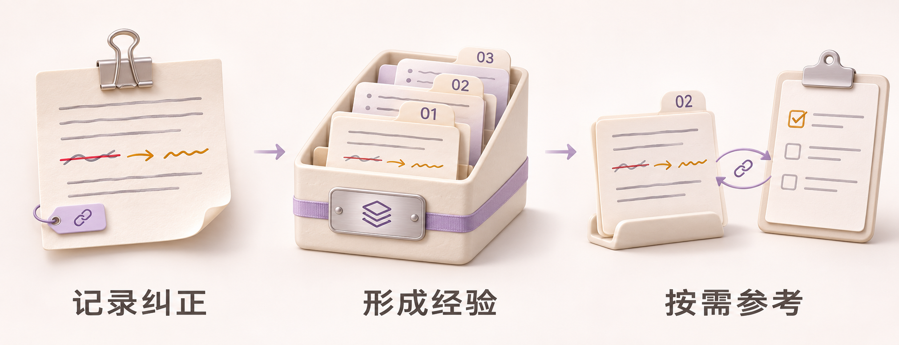
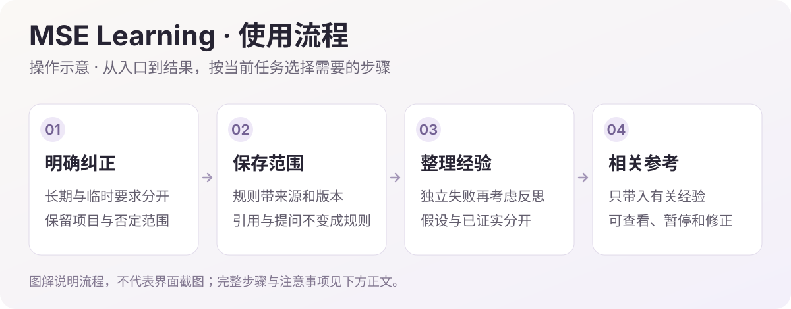

<h1>MSE Learning · 自我进化</h1>

让长期纠正和失败经验，在后续相关任务中派上用场。

  
  
  

<a href="#功能一览">功能一览</a> · <a href="#快速开始">快速开始</a> · <a href="#visual-guide">图解使用</a> · <a href="#使用场景">使用场景</a> · <a href="#常见问题">常见问题</a> · <a href="#详细文档">详细文档</a> · <a href="../README.en.md">English</a>

---

<!-- current-source -->
当前源码：**1.3.2** · [分支 `main`](https://github.com/Missher12/Missher-MSE-Learning/tree/main) · [安装包与验收](https://github.com/Missher12/Missher-MSE-Learning/releases/tag/v1.3.2)。
<!-- /current-source -->

## 功能一览

| 能做什么 | 说明 |
| --- | --- |
| **保存长期纠正** | 提取有来源的长期规则，保留否定、项目与临时范围。 |
| **失败复盘** | 从独立的同类失败中整理原因假设、修复步骤与检查办法。 |
| **按需召回** | 在相关任务中带回有限的方法和警示，控制上下文体积。 |
| **版本与状态** | 查看候选缺少的证据、经验修订与等待原因。 |
| **活动统计** | 按每日、每周与累计查看新增经验，导入记录单列。 |

## 快速开始

1. 从 [Releases](https://github.com/Missher12/Missher-MSE-Learning/releases) 下载对应版本的 `.tgz` 安装包。
2. 在 DSH **插件 → 添加插件** 中选择下载的文件，安装并启用；按宿主提示重新加载或正常重启。
3. 打开 **设置 → 自我进化**，查看规则、经验、学习状态与暂停开关。

<!-- visual-guide -->

## 图解使用流程

把有适用范围的长期纠正和失败经验，留给后续相关任务参考。

场景插画：帮助理解用途与操作顺序，不是 DSH 界面截图。

[查看完整流程图](../docs/images/workflow-guide.svg)

| 步骤 | 怎样操作 | 需要留意 |
| --- | --- | --- |
| 1. 表达长期规则 | 说明“以后”如何处理，并写清项目或其他适用范围。 | 只针对这一次的要求不能被提炼成全局长期规则。 |
| 2. 查看规则 | 在“设置 → 自我进化”核对规则、版本和处理状态。 | 普通纠正可能在空闲时提炼；问题、引文和日志不自动成为全局要求。 |
| 3. 整理失败经验 | 达到独立同类失败条件后进行有限反思。 | 同一次失败不重复计数；假设、验证结果和已证实经验分别记录。 |
| 4. 按需使用 | 相关任务中参考已保存的规则和方法，必要时暂停或调整。 | 经验用于帮助决策，不保证永不失败，也不把不适用规则强行注入。 |

### 试一次

> 以后在这个项目里，导出表格先保留原始列名，再另加中文说明；不要为了排版覆盖原文件。这是项目长期规则，不扩展到其他项目。

使用后可以这样核对：

- 规则保留“在这个项目”和“不要覆盖”的范围与否定含义。
- 来源、版本和状态可查看；重复记录不会被当成独立失败证据。
- 模型调用与只读查看分开理解，结果未知的付费步骤不自动重发。

### 设置怎么选

| 项目 | 建议 |
| --- | --- |
| 自我进化面板 | 查看规则、版本、检查和整理摘要；先核对来源，再修改或暂停。 |
| 后台整理 | 无新活动时跳过；空闲整理不会把每段聊天都变成永久规则。 |
| 费用与状态 | 查看面板不调用模型；提炼和反思可能产生用量，未知状态需要先核对。 |

MSE 侧重纠正与经验；[Memory Native](https://github.com/Missher12/Missher-DSH-Memory-Native) 侧重事实、偏好、决定及来源。两个插件按各自范围工作，不因同时安装就自动合并数据。
<!-- /visual-guide -->

## 使用前了解

- 自动提取、复盘和总结可能调用配置的模型并产生费用；只读查看不调用模型。
- 学习依据可证明的已登记工作区来源；未知费用请求不会自动重放，模型推测不冒充验证结论。

<!-- readme-expansion -->
## 使用场景

| 遇到的情况 | 怎样使用 |
| --- | --- |
| 同一种长期要求需要反复纠正 | 把有依据的长期纠正保存为规则，在相关任务中再次带回。 |
| 同类失败在不同任务中重复发生 | 积累具体失败经验、原因判断、修复步骤和检查方法，并保留修订。 |
| 需要知道后台到底学了什么、为什么没继续 | 在自我进化页面查看规则、经验、任务、等待原因、每日总结与暂停状态。 |

## 常见问题

自我进化是在训练模型权重吗？

不是。插件保存规则和经验，并在相关任务中提供有限提示；它不修改模型权重，也不保证所有错误从此消失。

为什么有些会话没有进入学习？

来源需要能证明属于宿主已登记的工作区，系统临时目录和无法确认的材料会被拒收或等待。一次性要求、引用、日志和纯提问也不会直接升级为长期规则。

后台是否每轮都会增加模型调用？

不是。普通纠正只在满足条件时进入有界提取；自动复盘和每日总结可能产生模型用量。只读查看不调用模型，未知费用请求不会自动重放。

学习内容会无限塞进上下文吗？

召回有范围和体积限制，每回合最多两条方法加一条风险提醒。经验版本还会根据后续结果修订，模型推测不能自己标成已验证。

## 搭配使用

[Memory Native](https://github.com/Missher12/Missher-DSH-Memory-Native) 保存事实、偏好与知识，MSE 侧重如何避免重复错误与遵守长期纠正；[Focus](https://github.com/Missher12/Missher-DSH-Focus) 提供当前任务的执行方法。

## 升级与数据

升级保留学习库、配置与既有用量记录。暂停后台与删除学习数据是不同操作；遇到等待状态先查看具体原因，不通过反复重发未知请求推进。
<!-- /readme-expansion -->

## 详细文档

[项目原说明](../README.md) · [发布说明](../PUBLICATION.md) · [验证记录](../VALIDATION.md) · [采集与学习边界](../docs/AUTONOMY_0.15.0.md) · [许可证](../LICENSE)

原有功能细节、配置、截图与验证记录保留在上述文档中，历史结论按其注明的版本理解。
