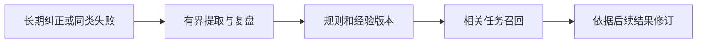

<h1>MSE Learning · 自我进化</h1>

让长期纠正和失败经验，在后续相关任务中派上用场。

  
  
  

<a href="#功能一览">功能一览</a> · <a href="#快速开始">快速开始</a> · <a href="#使用场景">使用场景</a> · <a href="#常见问题">常见问题</a> · <a href="#详细文档">详细文档</a> · <a href="../README.en.md">English</a>

---

<!-- current-source -->
当前开发源码：**1.2.1** · [分支 `main`](https://github.com/Missher12/Missher-MSE-Learning/tree/main)。安装包以实际 Release 为准。
<!-- /current-source -->

## 功能一览

| 能做什么 | 说明 |
| --- | --- |
| **保存长期纠正** | 提取有来源的长期规则，保留否定、项目与临时范围。 |
| **失败复盘** | 从独立的同类失败中整理原因假设、修复步骤与检查办法。 |
| **按需召回** | 在相关任务中带回有限的方法和警示，控制上下文体积。 |
| **版本与状态** | 查看经验修订、等待原因和每日总结，并暂停或恢复学习。 |

## 快速开始

1. 从 [Releases](https://github.com/Missher12/Missher-MSE-Learning/releases/tag/v1.2.1) 下载对应版本的 `.tgz` 安装包。
2. 在 DSH **插件 → 添加插件** 中选择下载的文件，安装并启用；按宿主提示重新加载或正常重启。
3. 打开 **设置 → 自我进化**，查看规则、经验、学习状态与暂停开关。

## 使用前了解

- 自动提取、复盘和总结可能调用配置的模型并产生费用；只读查看不调用模型。
- 学习依据可证明的已登记工作区来源；未知费用请求不会自动重放，模型推测不冒充验证结论。

<!-- readme-expansion -->
## 使用场景

| 遇到的情况 | 怎样使用 |
| --- | --- |
| 同一种长期要求需要反复纠正 | 把有依据的长期纠正保存为规则，在相关任务中再次带回。 |
| 同类失败在不同任务中重复发生 | 积累具体失败经验、原因判断、修复步骤和检查方法，并保留修订。 |
| 需要知道后台到底学了什么、为什么没继续 | 在自我进化页面查看规则、经验、任务、等待原因、每日总结与暂停状态。 |

## 工作方式

## 第一次使用

1. 打开“设置 → 自我进化”，检查学习开关、后台暂停状态和已有经验。
2. 在宿主已登记的真实项目会话中给出明确长期要求，或正常纠正当前工作。
3. 待来源回合结束和后台处理后，查看规则、来源及状态；在后续相关任务中核对实际召回。

### 一个具体例子

长期规则示例：“以后这个项目的报错说明使用中文，并保留原始错误码。”一次性调整则应写清“这次”，避免把临时要求误当成长久约定。

## 常见问题

自我进化是在训练模型权重吗？

不是。插件保存规则和经验，并在相关任务中提供有限提示；它不修改模型权重，也不保证所有错误从此消失。

为什么有些会话没有进入学习？

来源需要能证明属于宿主已登记的工作区，系统临时目录和无法确认的材料会被拒收或等待。一次性要求、引用、日志和纯提问也不会直接升级为长期规则。

后台是否每轮都会增加模型调用？

不是。普通纠正只在满足条件时进入有界提取；自动复盘和每日总结可能产生模型用量。只读查看不调用模型，未知费用请求不会自动重放。

学习内容会无限塞进上下文吗？

召回有范围和体积限制，每回合最多两条方法加一条风险提醒。经验版本还会根据后续结果修订，模型推测不能自己标成已验证。

## 搭配使用

[Memory Native](https://github.com/Missher12/Missher-DSH-Memory-Native) 保存事实、偏好与知识，MSE 侧重如何避免重复错误与遵守长期纠正；[Focus](https://github.com/Missher12/Missher-DSH-Focus) 提供当前任务的执行方法。

## 升级与数据

升级保留学习库、配置与既有用量记录。暂停后台与删除学习数据是不同操作；遇到等待状态先查看具体原因，不通过反复重发未知请求推进。
<!-- /readme-expansion -->

## 详细文档

[项目原说明](../README.md) · [发布说明](../PUBLICATION.md) · [验证记录](../VALIDATION.md) · [采集与学习边界](../docs/AUTONOMY_0.15.0.md) · [许可证](../LICENSE)

原有功能细节、配置、截图与验证记录保留在上述文档中，历史结论按其注明的版本理解。
