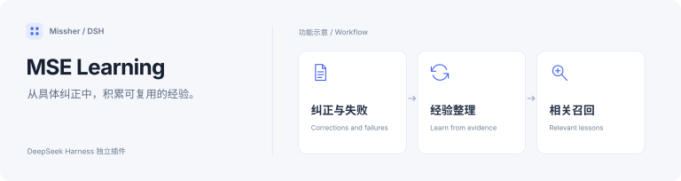

<h1>MSE Learning · 自我进化</h1>

让长期纠正和失败经验，在后续相关任务中派上用场。

  
  
  

<a href="#功能一览">功能一览</a> · <a href="#快速开始">快速开始</a> · <a href="#详细文档">详细文档</a> · <a href="../README.en.md">English</a>

---

<!-- current-source -->
当前开发源码：**1.2.1** · [分支 `main`](https://github.com/Missher12/Missher-MSE-Learning/tree/main)。安装包以实际 Release 为准。
<!-- /current-source -->

## 功能一览

| 能做什么 | 说明 |
| --- | --- |
| **保存长期纠正** | 提取有来源的长期规则，保留否定、项目与临时范围。 |
| **失败复盘** | 从独立的同类失败中整理原因假设、修复步骤与检查办法。 |
| **按需召回** | 在相关任务中带回有限的方法和警示，控制上下文体积。 |
| **版本与状态** | 查看经验修订、等待原因和每日总结，并暂停或恢复学习。 |

## 快速开始

1. 从 [Releases](https://github.com/Missher12/Missher-MSE-Learning/releases/tag/v1.0.0) 下载对应版本的 `.tgz` 安装包。
2. 在 DSH **插件 → 添加插件** 中选择下载的文件，安装并启用；按宿主提示重新加载或正常重启。
3. 打开 **设置 → 自我进化**，查看规则、经验、学习状态与暂停开关。

> 这是私有仓库，需要使用有访问权限的 GitHub 账号查看和下载。

## 使用前了解

- 自动提取、复盘和总结可能调用配置的模型并产生费用；只读查看不调用模型。
- 学习依据可证明的已登记工作区来源；未知费用请求不会自动重放，模型推测不冒充验证结论。

## 详细文档

[项目原说明](../README.md) · [发布说明](../PUBLICATION.md) · [验证记录](../VALIDATION.md) · [采集与学习边界](../docs/AUTONOMY_0.15.0.md) · [许可证](../LICENSE)

原有功能细节、配置、截图与验证记录保留在上述文档中，历史结论按其注明的版本理解。
