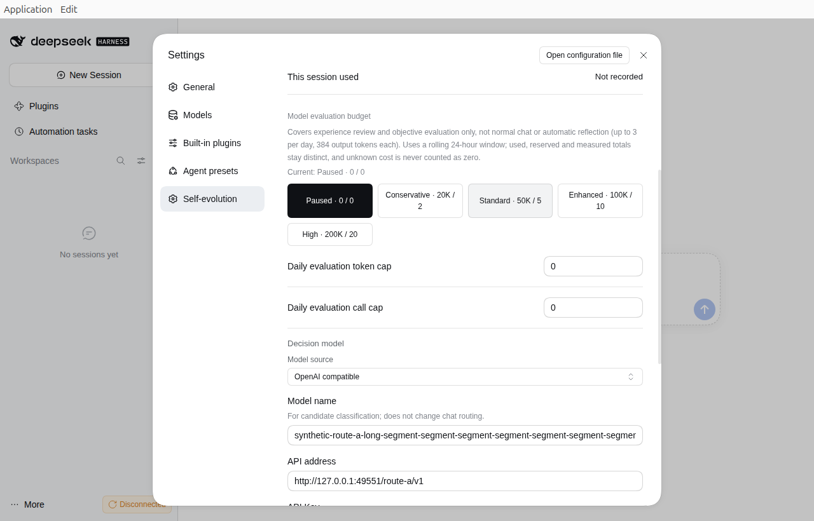
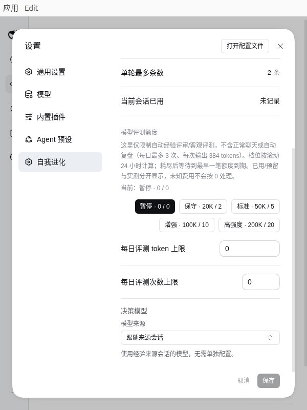
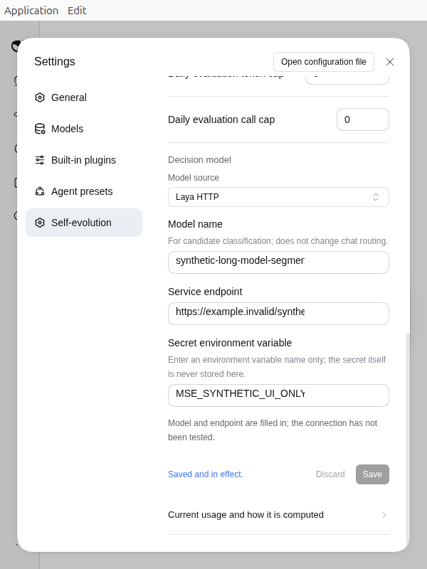
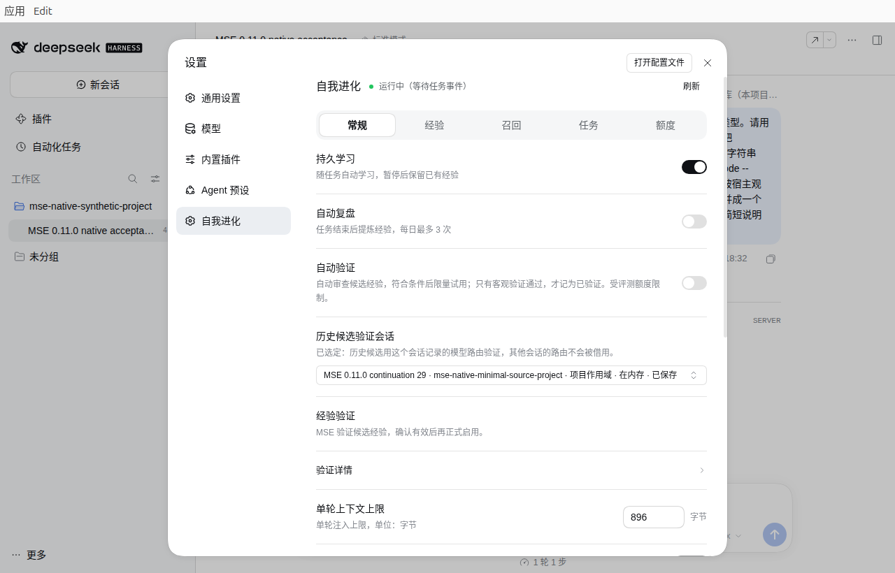

# MSE Learning 0.13.0 交付记录

本版的定向回归、三个包及限定原生设置验收已通过。正式安装资产以 [v0.13.0 版本页](https://github.com/Missher12/Missher-MSE-Learning/releases/tag/v0.13.0)为准；仓库或 Release 更新不会自动升级其他设备，安装后应确认插件显示 0.13.0。

[桌面端与全部插件](https://github.com/Missher12/Missher-DeepseekHarness-Desktop) · [中文说明](README.md) · [English](README.en.md) · [验证记录](VALIDATION.md)

## 这次更新

- 预算设置改为滑轨和精确输入；保留自定义数值，支持键盘调整、保存及丢弃草稿。
- 新增有限 / 不限额模式。默认有限；不限额取消共享滚动 24 小时的 token 和逻辑任务总额，保留真实用量记账、单次请求限制、单并发、暂停和费用未知时的防重复处理。
- 模式切换保留原有限额度；切回有限后继续使用。自动验证仍是独立开关，升级不会自动替其他用户开启不限额或自动验证。
- 保存后再次编辑时清除旧成功提示，使页脚状态与当前草稿一致。
- 收据账本扩展至最多 4096 行，状态文档保留 2 MiB 上限；容量计算包含落盘版本号增长，不丢弃活跃或费用未知的记录。

0.12.1 的滑轨修改合并到本版，没有单独发布和安装。兼容接入仍按宿主能力判断，没有新增精确版本锁定，也没有修改 Host。

## 验证与交付

最终客户端回归 **48/48** 通过；核心 R4 的 189 项相关 Node 与 58 项 Hermes 通过记录按未变源码复用，不把重叠用例相加。原生确认滑轨、精确输入、模式切换、保存/丢弃及正常重启持久化；随后只补查保存后编辑的页脚提示，实际回读确认未保存草稿不改变已生效设置。

最终源码 155 个文件，DSH / Hermes / 源码包为 71 / 45 / 155 项；分别 45 / 29 / 129 个非文档成员与已验 R6 一致。19 份原公开历史文档和图片保持原字节，新增两张合成数据的实际预算截图。

测试环境是保留既有客户端定制的 Ubuntu 社区 0.2.1-rc.2，检查中英文约 311 / 559 像素实际内容宽度；没有新增真实模型请求，不代表纯官方桌面封包、其他平台或 Hermes 原生 UI 已验收。最终补图封包没有重跑代码或界面矩阵。

## 安装资产与校验和

| 文件 | 文件数 | SHA-256 |
| --- | ---: | --- |
| `missher-dsh-mse-learning-0.13.0.tgz` | 71 | `a3e30a1cc8bbabfdb53e14c4aae96007befed5a3cc6a0d9c406ef397c63ee743` |
| `mse-learning-hermes-0.13.0.tar.gz` | 45 | `b5916c125a4f6d75b316b777259f852ecd5a89bd97d992f11d584457d829b1bd` |
| `mse-learning-0.13.0-source.tar.gz` | 155 | `6bb6dc7e078fc1a6061247b65a92066be127455b813956187e912942cd8d89a8` |

版本页同时提供 `VERIFICATION.json` 和 `SHA256SUMS`。公开源码摘要、测试范围及限制在验证文件中；本交付记录留在 Git，避免把归档自身校验和写回归档形成循环。

## 实际预算界面

下图来自本版隔离环境，只含合成配置；后台开关关闭，背景连接提示来自网络隔离。

[查看窄屏布局](docs/images/native-rc2-0.13.0-budget-narrow.png)

## 升级与回退

安装前保存新鲜备份，并保留当时的预算、后台开关、模型配置、会话、队列和学习记录。升级不替换现有配置为测试值，也不保存尚未提交的表单草稿。不限额需用户明确选择并保存；已选择时费用可持续增加。

需要回退时使用 0.12.0 安装包及升级前的对应备份，勿把新数据直接覆盖为旧快照。历史标签、安装资产、验证记录与图片继续保留。

## 0.12.0 历史交付记录（保留）

0.12.0 的客户端回归、最终三个包和限定原生设置验收已通过。正式安装资产以 [v0.12.0 版本页](https://github.com/Missher12/Missher-MSE-Learning/releases/tag/v0.12.0)为准；仓库或 Release 更新不会自动升级其他设备，安装后应确认插件显示 0.12.0。

[桌面端与全部插件](https://github.com/Missher12/Missher-DeepseekHarness-Desktop) · [中文说明](README.md) · [English](README.en.md) · [验证记录](VALIDATION.md)

## 这次更新

- 在同一设置页填写模型、API 地址与真实 API Key。密钥由宿主按后端和服务路线保存，普通设置和状态只使用凭据元数据。
- 可按需获取模型目录并选择模型，也保留手动填写。目录读取不运行推理，服务没有目录不等于推理接口不可用。
- 修正输入框实际编辑宽度、窄屏提示换行和预算按钮上下留白；中英文布局沿用 DSH 控件。
- 凭据保存发生外部设置冲突后，单次重新加载先读回最新宿主配置，再重建草稿并刷新凭据状态。失败或期间有新输入时保留草稿，不重试已拒绝的写入。

## 验证范围

43 项客户端回归通过。未变的后端定向检查和四项控制面检查沿用本轮对应源码证据；最终文档封包没有重跑整组代码测试或原生矩阵。三个归档的非文档成员分别 45 / 29 / 129 项，与原生验收 R8 逐字节相同。源码共 151 个文件，包含真实合成数据截图。

隔离 Ubuntu 社区 0.2.1-rc.2 完成普通及 Key-only 保存/取消、合成目录和手动回退、正常重启读回、中英文 311 / 559 像素布局，以及最后的凭据冲突恢复。没有新增模型请求，没有把目录 GET 当作推理效果测试。测试环境保留既有客户端定制，不作为纯官方桌面封包或其他平台的完整验收证明。

顶部 Per turn 来自独立的 overview 快照，依现有页面 Refresh 更新；不宣称所有运行摘要随重新加载设置立即刷新。原生未强制制造的存储失败、部分成功、并发写入和内部 unload 分支不计为原生通过。本轮所测宿主的凭据存储是权限受限的本地文件，并非系统钥匙串或加密保险库。

## 安装资产与校验和

| 文件 | 文件数 | SHA-256 |
| --- | ---: | --- |
| `missher-dsh-mse-learning-0.12.0.tgz` | 67 | `b8b595f31d0bca55fd6d93dbed51a9644ac5293f769d2e96c1f10c7bd94cf9f2` |
| `mse-learning-hermes-0.12.0.tar.gz` | 43 | `40c180736601a6ef5615d9fa9a29a012bf3fde3c34997ce48871b2584d116c00` |
| `mse-learning-0.12.0-source.tar.gz` | 151 | `afdf5ea4ada690433cfec860fe01620e84772e399c458f17d070a7ab05e4bab9` |

版本页还提供 `VERIFICATION.json` 和 `SHA256SUMS`。前者列公开源码摘要、验证范围与限制，后者可用于校验下载文件。包内 README、说明和截图对应本次最终冻结；此交付记录位于 Git，避免把归档自身校验和写回归档造成循环。

## 升级与回退

安装前保留新鲜备份，保存实际预算、后台开关、模型配置、会话、队列和学习记录。升级不会用测试的零预算或旧默认值覆盖现有设置，也不会替你保存尚未提交的表单草稿。需要回退时使用 0.11.1 包与升级前对应备份；历史标签、已发布包和验收记录保留。

本次没有改 Host 或新增精确宿主版本限制。插件按所需能力接入；未测试的宿主和平台组合不宣称全部通过。

## 实际界面

以下来自离线隔离环境，只含合成模型和回环地址；密码输入框为空，背景 Disconnected 不代表生产服务失败。

## 0.11.1 历史交付记录（保留）

0.11.1 的客户端测试、三个包和原生设置界面已通过本次验收。正式安装资产以 [v0.11.1 版本页](https://github.com/Missher12/Missher-MSE-Learning/releases/tag/v0.11.1)为准；旧设备需实际安装后才会升级。

[桌面端与全部插件](https://github.com/Missher12/Missher-DeepseekHarness-Desktop) · [使用说明](README.md) · [详细验证记录](VALIDATION.md)

### 这次改了什么

- “模型来源”有明确标签；跟随来源会话时收起不使用的远程配置。
- 选择远程服务后展开等宽输入框，缩短说明文字，切换保留草稿。
- 保持保存与取消行为，补齐 Hermes 包中的新版说明文档。
- 学习核心、预算、调度和模型调用不变；沿用按能力接入及现有宽版本范围，不新增精确宿主版本限制。

### 验证范围

31 项客户端检查通过。原生中英文、四后端、键盘、草稿、保存回读及取消已在隔离 Ubuntu 社区 0.2.1-rc.2 完成，实际内容宽约 311 / 559 像素。本轮模型请求为 0；没有重跑核心测试或宣称其他平台、纯官方桌面与未测版本的新验收结论。

### 三个安装与源码包

| 文件 | 用途及文件数 | SHA-256 |
| --- | --- | --- |
| missher-dsh-mse-learning-0.11.1.tgz | DSH 插件，59 项 | 552eabcdbab4ea98cca938030759ae5e3fcd9e9f1b5a62a16fa420af96dcc546 |
| mse-learning-0.11.1-source.tar.gz | 冻结源码，143 项 | a13e52882f5eceed123fdb0311089309a389c01afecb6157b7fd502061ea0acb |
| mse-learning-hermes-0.11.1.tar.gz | Hermes 适配器和共用核心，42 项 | a1f901544fe3f9003c9d797cc6c426d6e5a157bcea5067aefe82e7620747041a |

安装包保持验收时的原始字节；包内文档保留冻结时状态，后续验证结论以本页和版本页为准。Git 补充最终说明与真实的合成数据截图，产品运行代码、测试及打包脚本与最终冻结源码一致。个人会话、学习数据、凭据和私有验收资料不进入公开包。

### 升级与回退

升级保留已有设置、会话、队列、学习记录和费用数据，不使用测试环境的零预算或远程示例覆盖日常配置。安装前备份；需要回退时使用保留的 0.11.0 包和对应备份。0.11.0 标签、安装包和原始证据继续保留。

### 真实界面

以下为离线隔离环境的真实控件，均使用合成数据：

### 0.11.0 历史记录（保留）

0.11.0 已完成本轮定向检查、三个包的源码一致性核验及原生恢复复盘验收。正式下载请从下面的 Releases 入口选择 `v0.11.0`；安装后在插件页面确认实际版本。

[桌面端与所有插件](https://github.com/Missher12/Missher-DeepseekHarness-Desktop) · [MSE Releases](https://github.com/Missher12/Missher-MSE-Learning/releases) · [安装说明](README.md)

#### 这次更新

- 在同一项目、环境与验证条件下，把两个冻结候选合成为一个新候选；生成结果必须重新验证，不能继承父项的信用。
- 决策和评测保存来源、票据、进度及费用。重启复用已完成步骤，费用未知的请求不会自动重放。
- 对已知、已结算的特定复盘失败提供一次性授权恢复。新复盘使用 2048 token 输出上限并检查完整结束；旧费用、冷却时间和失败历史保留。
- 设置页保留中英文会话选择器、暂停、预算和详情。按宿主提供的能力接入，peer 范围不锁定某个精确 DSH 版本。

#### 已验证与限制

本轮最新 53 个适用定向用例通过，三个包的全部文件与冻结源码逐字节一致。另有 18 项私有执行保护检查通过；它们验证防重复调用与额度控制，不冒充产品或真实模型测试。

真实 Host 链路已产生有效决策、安全评审及客观拒绝，候选因未证明改进而暂停，试用被撤回。这个结果证明拒绝路径工作，不能宣称模型获得了正向提升。Laya 接口和记账通过，但五例决策只有两例符合预期且对标签敏感，不建议把该实例作为独立裁决器。

Ubuntu 社区 rc.2 的实际设置页与候选详情已观察。恢复复盘已通过正式接口完成：仅一次请求，输出上限 2048 tokens，实际结算 1,118 tokens；生成新候选，采用数和验证数仍为 0。旧票据、费用和学习记录保留，测试结束后两个后台开关关闭、凭据清除并正常退出。纯官方桌面、其他宿主版本、Windows 和 macOS 的本轮完整流程没有新增验收结论；旧版本证据不能直接外推。详见 [验证记录](VALIDATION.md)。

#### 三个包

| 文件 | 用途 | SHA-256 |
| --- | --- | --- |
| missher-dsh-mse-learning-0.11.0.tgz | DSH 插件 Bundle | 9ea5bf37c8303d0494d0a7db965feb317a9f389c949939e60081e7350e75169a |
| mse-learning-0.11.0-source.tar.gz | 142 文件的冻结源码 | cb854ffd8ea96ca2a8187c32109cd2cf00d0ba2d8aae3fa94cf5c45a96bbf071 |
| mse-learning-hermes-0.11.0.tar.gz | Hermes 适配器与共用运行核心 | a9fd14ffd9e5fabfbb7e81d6f184a0073783537cfea9eff131edee084f9bbcb2 |

安装包保留实际参与验收的原始字节。Git 中补充验收后的文档与合成数据截图，运行代码和测试代码与冻结包一致。历史版本和标签继续保留。个人学习库、会话、凭据及私有验收材料不包含在这些包或公开仓库中。

#### 配置与升级

公开包默认关闭自动验证，评测 token 预算为 0。需要后台验证时，在设置中明确选择预算并保存；任务数与物理模型请求数分开计数。升级保留已有上下文限额、学习数据、来源与费用记录，不把测试环境配置覆盖到日常环境。切换版本前保留同版本数据备份，出现问题可用原包与备份回退。

#### 实际界面

隔离 Ubuntu 社区 rc.2 原生设置页，合成数据、两个后台开关关闭：

