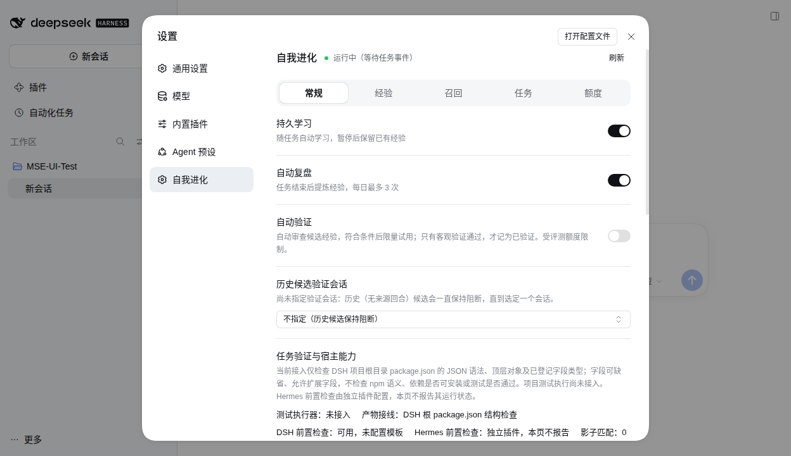
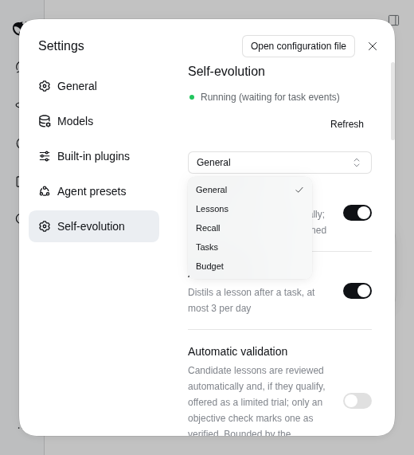

# MSE Learning

English | [中文](README.md) · [Desktop and downloads](https://github.com/Missher12/Missher-DeepseekHarness-Desktop)

Persists scoped user corrections and method candidates for DSH, recalls relevant lessons within a byte budget, and records adoption and verification established by the trusted host. It does not train model weights or guarantee that a model will never repeat a mistake.

Package: `@missher/dsh-mse-learning`, version 0.10.0. It provides host-bound task evidence, bounded package.json artifact checks, failure/control replay, and DSH/Hermes adapters. Evidence is listed by acceptance layer in [Validation](VALIDATION.md); capabilities and limits are in [the implementation notes](docs/AUTONOMY_0.10.0.md). See the [0.10.0 delivery record](PUBLICATION.md) for native desktop and official Web acceptance, checksums, and downloads. The full suite, installation on each user computer, and real paid-model effectiveness remain outside the verified scope.

The host-title session pickers from alpha.17 remain. Titles are display-only and do not alter scope, recall identity or budgets. This upgrade changes the shared core; DSH scheduling does not establish equivalent lifecycle integration for every Agent. The historical `dsh-missher-evolution` package is a separate product; this plugin does not read or migrate its data.

## Features and cost

- Capture explicit corrections from host-authenticated user input; recall them by scope, supported applicability conditions and remaining budget.
- Keep inferred methods as candidates; safety review can admit a limited trial, while objective evidence is required for validation within a declared domain.
- Use **Settings → 自我进化 (Self-evolution)** for lessons, recall explanations, pause/resume, manual review, budgets and actual control acknowledgement.
- Recover acknowledged completion settlements after restart without rerunning models or tools or crediting a result twice.
- `/mse` shows status, `/mse why` explains recent recall, and `/mse now <task>` provides a read-only preview. They use the host command service instead of ordinary model messages.

Default recall limits are **2 lessons / 768 UTF-8 bytes per turn** and **1536 bytes per session**. Bytes are not tokens. Retrieval makes no model calls. Automatic reflection can make additional calls using the model and reasoning effort of the source turn that triggered reflection: at most 3 per 24 hours, at least 30 minutes apart, and at most 384 output tokens each. It can be disabled separately. Additional model evaluation defaults to `evaluationTokensPerDay=0`; it does not start paid evaluations automatically.

## Automatic review and validation

- **Trial does not mean proven benefit.** Candidate and baseline answer independently on the same route; a separate judge sees anonymous answers and checks both label orders. Safe, applicable advice with known costs can become `reviewed` / `trial`; a neutral-safe tie still has `benefit=unproven`. Injected trial text explicitly identifies its unverified status.
- **Objective evidence determines validated.** Registered algorithms or the Host-owned `mse-lifecycle-v1` scenario pack supply fixed checks; models supply answers only. Injection, model self-reports and claimed success are not verification. A domain verdict covers its registered request-generation, concurrent-ticket and acceptance-evidence cases, not arbitrary tasks.
- **Automatic validation is off by default** (`autoValidationEnabled=false`) and the evaluation token budget defaults to **0**. An explicit zero issues no paid evaluation calls. Manual and automatic evaluations share rolling 24-hour limits and reserve before requesting; unknown usage is not zero.
- **Evaluation presets** are pause, 20K/2, 50K/5, 100K/10, 200K/20 and custom. A task is a distinct ticket that dispatched at least one physical request in the rolling 24-hour window; multiple steps in one task count once. Physical provider requests are counted separately. Missing budget fields in legacy settings remain fail-closed at 0/2; a preset takes effect only after explicit selection and save.
- DSH and Hermes persist per-step request identity, response and usage. Resume reuses completed steps; a dispatched step with unknown cost is never replayed. A fresh Hermes process resumes only after the original source session reports a trusted `pre_api_request` route again; without that proof it waits.
- New candidates bind their actual source session/turn and route. Historical candidates whose source cannot be recovered require an **explicit verification session**. Its provider/model/reasoning effort supplies the backfill route without changing the original project or silently borrowing the latest session's model.
- The overview separates recorded lessons, corrections, pending work, trials, validation and adoption. Library-wide reads do not widen recall scope. Original applicability/exclusion text remains; unsupported conditions block recall with a visible reason.

At most **one trial per turn** can use the existing **total 2-lesson/default 768-byte turn budget and 1536-byte session budget**, after corrections and validated methods; it adds no extra context allowance. Trials expire and may be withdrawn after trusted failure/correction evidence. Pause/disable stops later steps; uncertain requests after restart retain interruption facts and conservative charges rather than silently replaying the same request. Reading the overview, lesson details, status or diagnostics neither writes the learning store nor triggers paid work. The same settings page also exposes human-initiated configuration saves, enable/pause controls and manual reflection/validation actions. These are write or scheduling entry points; enabling automatic validation can schedule budgeted background evaluations. See [VALIDATION](VALIDATION.md) for the tested cancellation, recovery and accounting scope and its limits.

## Installation status

The isolated checks below have passed for 0.10.0. Download the matching package from the [release page](https://github.com/Missher12/Missher-MSE-Learning/releases/tag/v0.10.0) and verify its checksum. Updating Git and release assets does not install them on your computer. See the [delivery record](PUBLICATION.md) for the exact scope.

## Start automatic validation

1. Confirm the version and checksum on the project release page before installing.
2. Turn on **automatic validation**. For historical candidates without a recoverable source, explicitly select a **verification session** with a configured model route. It supplies the provider, model and reasoning effort without changing the lesson's original project.
3. Set a **nonzero evaluation token allowance** you accept, and ensure the evaluation-count allowance permits a plan. After saving, inspect actual control acknowledgement, queue stages and blocking reasons. A recorded candidate does not imply immediate promotion.
4. Distinguish recorded lessons, trials and validation. Safety review can admit a trial; objective checks are required for validated status within the registered domain. Turning off automatic validation stops later automatic steps. Reflection has its own switch and frequency limits.

Defaults remain **automatic validation off, token allowance 0 and task allowance 2**; legacy settings missing budget fields also use 0/2. A preset changes these values only after explicit selection and save. Tasks and physical requests are counted separately. Reading the page does not start models.

## Settings screenshot

Both images use the same 0.10.0 package, isolated profiles, synthetic data, and disabled automatic validation.

Actual Chinese Web settings on official npm DSH 0.2.1-alpha.5, with save, persisted readback, and discard verified.



Real minimum window (520×600) on community Desktop 0.2.1-alpha.2.20261014.1 for Linux. The Host menu keeps all five English navigation labels readable and opens their corresponding panels.



[The earlier English screenshot](docs/images/en-normal.png) is retained only as historical layout evidence.

## Evidence and platform boundaries

| Environment | Evidence and limits |
| --- | --- |
| 0.10.0 core and host evidence | Automatic scheduler 11/11; complete single-instance Hermes chain in 61.156 seconds; official npm DSH alpha.5 Loader passed normal, missing-fs, and missing-tools cases. See [Validation](VALIDATION.md) for scope and limits. |
| Historical alpha.18 Intel Mac candidate | The earlier 303/303 Node, 125/125 offline adapter, 189/189 controlled UI and four real review calls belong only to that historical candidate. They are not current-candidate or daily-install evidence. |
| Unmodified official DSH, later DSH versions, Windows and Ubuntu | Full compatibility is not claimed. Permissive `*` peers do not prove the required interfaces exist. |
| Hermes 0.21.1 | Current adapter/core offline Stage 4c integration passed 21/21, including 20K window recovery, rebuilt driver/pass and trusted source-session route event. This is historical adapter-layer evidence; the current isolated native PluginManager single-instance run is recorded separately above and is not an added count. |
| Other Agents | A host-independent Node SDK and JSON CLI are available, but a trusted lifecycle adapter is required. This is not automatic support for every Agent or a browser SDK. |

DSH must provide Cordis, LLM, Typert, Schemastery, commands/settings and related services. The complete settings UI also requires the static `@deepseek-ai/dsh-client-ui-primitives` module and matching settings extension points; the tested combination is Missher Desktop. Official packages are host-provided peers, not a bundled replacement host. Report the host version and redacted loading error when interfaces are missing; a version exemption is not a compatibility test.

## Pause, removal and retained data

Turn off enablement in **Settings → 自我进化** and check that persistent control has been acknowledged. A busy lock can leave it unconfirmed; a saved settings document alone is not confirmation. Disable automatic reflection separately to retain recall without starting new reflections; automatic validation has its own switch.

Before uninstalling, let active tasks finish and back up the entire host-resolved `dshHomePath('mse-learning')` directory, normally `mse-learning/` under the DSH data root. Include both `lessons-v1.json` and `sessions/`. Remove the package through Desktop's plugin manager, or from the same CLI / Web profile:

```sh
dsh plugin --profile web remove @missher/dsh-mse-learning
```

There is no uninstall data-deletion script; removing the package does not actively erase its learning store. If you want to erase personal data, first stop the relevant host, then manage that directory and its backups yourself. Do not delete the entire DSH data root or another plugin's directory. DSH and Hermes must not share a live writable learning store. A detected legacy `missherEvolutionCore` pauses the new controller.

The historical alpha.15/alpha.16→alpha.17 upgrade stayed on schema 2. Version 0.10.0 continues using optional schema-2 fields; retain a fresh complete backup before a formal upgrade. Schema 1 needs explicit migration. Before downgrading to a package without durable settlement support, drain/retire pending settlements, or restore both the corresponding old package and the complete pre-upgrade backup. See the [durable settlement contract](docs/DURABLE_SETTLEMENT_OUTBOX.md).

## Development and verification

The repository's legacy-store fixtures are synthetic, not personal learning data. Node tests use one worker by default:

```sh
npm test
node scripts/pack.mjs --dsh-only
node scripts/pack-source.mjs
node scripts/verify-package.mjs
```

Use a fresh source copy or output directory for each build; packers reject existing candidate artifacts. `MSE_SOURCE_COMMIT` identifies the 40-character commit for an export without `.git`. Isolated host scripts take explicit artifact, Host modules and pnpm paths. UI verification requires `MSE_DSH_SOURCE` and `MSE_PLAYWRIGHT_ANCHOR`, with no maintainer-specific fallback. Optional historical alpha8 comparisons use `MSE_ALPHA4_ENGINE` and `MSE_ALPHA6_ENGINE`.

[Autonomy implementation notes](docs/AUTONOMY_0.10.0.md) · [Adapter protocol](docs/ADAPTER_PROTOCOL.md) · [Durable settlement](docs/DURABLE_SETTLEMENT_OUTBOX.md) · [Detailed behavior, Chinese](docs/BEHAVIOR.zh.md)

Arbitrary free-form Chinese conditions are not reliably understood; unclear conditions conservatively block recall. Unacknowledged work and manual model jobs do not have a cross-crash durability guarantee. Tests, readable settings and growing counters do not establish long-term model improvement. This round of real-provider acceptance covers bounded review only, not paid objective two-arm validation. Controlled browser UI evidence is separate from daily native-window acceptance.

## License and attribution

[MIT](LICENSE), Copyright © 2026 Missher. DSH/Cordis/Schemastery interfaces come from [DeepSeek Harness](https://github.com/deepseek-ai/deepseek-harness); host-provided packages retain their own licenses. The Hermes adapter targets [NousResearch/hermes-agent](https://github.com/NousResearch/hermes-agent). The [RRSI research note](docs/RRSI_RESEARCH_2026-09-30.md) records design references; it does not mean RRSI is bundled or that either upstream endorses this plugin.
