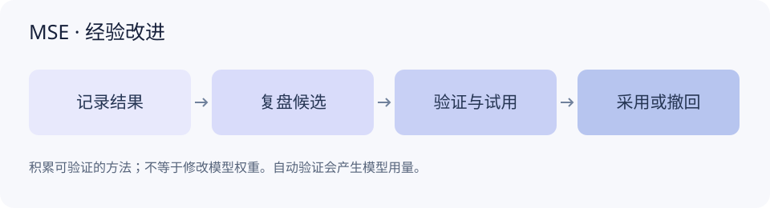
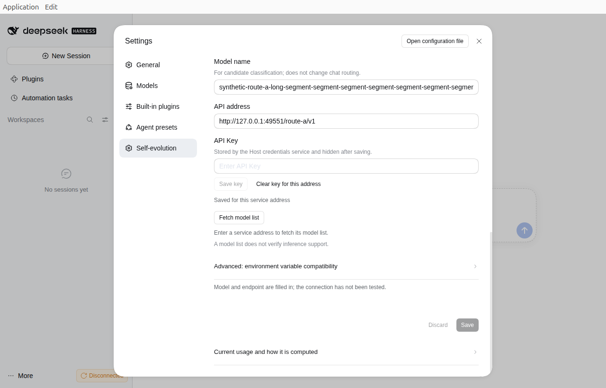
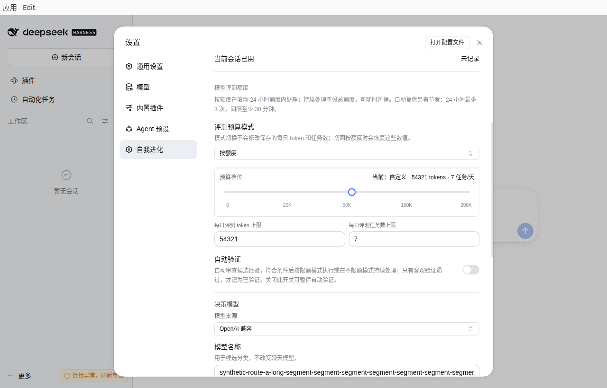

# MSE 自我进化

**把任务中的纠正和有用做法保存为项目经验，在相关任务中按需使用，并持续检查它们是否仍然适用。**

MSE 的长期积累对象是经验、方法、适用条件和验证证据。它不会修改大模型权重，也不能保证所有错误从此不再发生。模型可以帮助整理和评审，正式采用仍受客观验证、项目范围、成本和撤回规则约束。

包名为 `@missher/dsh-mse-learning`。本文描述现有能力与“界面先行”候选，候选沿用 0.13.0 源码版本；正式版本由发布记录确定。新界面的离线检查已通过，真实宿主界面验收、发布和安装仍待完成。

*流程示意，非运行截图；不表示每条候选都能通过验证。*

## 在哪里使用

在 DSH 的“设置 → 自我进化”查看经验、召回、任务与额度。日常对话中明确纠正错误，或说明以后应遵守的项目做法，MSE 可在支持的来源和权限范围内记录它。任务结果也可通过宿主接入形成方法候选。

经验保留项目和来源信息。其他项目不会因为关键词相似就自动获得这条经验；切换会话时，页面按宿主解析的可访问项目更新。不能读取的会话会报告失败，不回退为全库查询。

可使用 `/mse` 查看状态、`/mse why` 查看最近召回的依据，或 `/mse now <任务>` 为当前任务查询适用经验。命令能力以所在宿主的实际接入为准。

## 新总览与活动日历

这次界面调整保留已有模型、预算、手动操作和保存功能，增加紧凑概况、按天的热力图、日期详情与近期活动。

| 页面内容 | 可以了解什么 |
| --- | --- |
| 经验概况 | 当前留存经验和验证状态；扫描不完整时显示覆盖提示 |
| 活动热力图 | 选中项目在 30、90 或 366 天内仍保留的经验创建和验证记录 |
| 每日、每周、所选范围已记录 | 对同一批去重记录使用不同聚合方式；不代表终身累计 |
| 日期详情 | 当天可追溯的记录与事件类型 |
| 模型与用量 | 决策路线、任务数、实际请求数，以及已知、预留或未知用量 |

日历支持时区与配色选择。没有完整记录的日期显示“无完整记录”，不补成已确认的零；同一验证证据不会因为有多个引用而重复计数。热力图颜色越深只表示所选活动记录更多，不等于能力提升更多。

自然日活动与滚动 24 小时费用分别展示。现有短期账本不足以恢复每天 Token 用量时，页面不会用估算值补历史。全库经验概况、本实例用量和所选项目活动分别标明范围。

此处日历说明对应开发候选，尚无本候选真实宿主截图。不能用下方历史图片证明新日历已通过实际界面验收。

## 从候选到采用

| 状态或事件 | 含义 |
| --- | --- |
| 已记录的纠正 | 保存了明确来源的要求，仍须满足项目范围和召回条件 |
| 方法候选 | 有待进一步评审的做法，不能仅凭模型推荐算作有效 |
| 评审、受限试用 | 在适用范围内有限使用，仍可能缺少客观收益证明 |
| 已验证 | 通过该领域已登记的验证路径；结论只覆盖实际验证的条件 |
| 采用 | 某次任务实际召回或使用了经验，不等于已证明任务改善 |
| 撤回、过期 | 不再继续以原状态参与使用，保留可追溯记录 |

有客观验证器并满足所有条件时，系统可以自动推进；缺少验证能力、证据不足、来源不可用或请求费用未知时，会等待或报告原因。模型评审和安全平局不能替代客观收益证据。合并、改写会形成保留来源的新候选，不直接覆盖原经验并宣告晋升。

开启不限额也不会降低晋升门槛、绕过项目隔离，或把已发送但结果未知的请求自动重放。

## 模型、API 和密钥

决策模型用于评审候选与建议下一步，执行任务的模型可使用另一条路线。可选择宿主模型、OpenAI 兼容服务、Jev 或 Laya。

*历史真实界面：MSE 0.12.0，Ubuntu 社区 DSH 0.2.1-rc.2，隔离环境合成数据。背景 Disconnected 为当时离线状态；图片不证明当前版本或服务已经连通。*

- **使用宿主模型**：来源会话决定实际模型路线，需要宿主支持相关能力。
- **使用外部服务**：配置模型、服务 API 根地址及 Key。Key 使用宿主凭据服务或环境变量引用；导出配置不包含明文 Key。
- **获取模型目录**：按已选后端查询服务提供的模型，减少手写名称。目录为空或服务不支持时，可按服务说明手动输入。
- **Jev / Laya**：按各自结构化协议调用。Laya 服务独立运行，插件不会自动下载或加载模型。不同后端的置信度含义不同，不共用晋升阈值。

保存成功、目录可读取、API 可连接、实际推理通过是不同结果。不能根据其中一步显示“全部已验证”。历史 Laya 小样本测试存在误判和标签敏感性，不能视为通用决策准确率或长期自进化收益证明。

## 自动运行与用量

在“自我进化”中选择自动复盘、自动验证及预算并保存，状态页会解释等待原因。新安装默认自动验证关闭、评测 Token 额度为 0；升级保留已保存配置，不把已有不限额模式改回默认档。

*历史真实界面：MSE 0.13.0，Ubuntu 社区 DSH 0.2.1-rc.2，隔离环境合成设置。不是本轮新总览的验收截图。*

有限模式可选择 20K / 2、50K / 5、100K / 10、200K / 20，或精确输入额度。这里分别是滚动 24 小时评测 Token 与逻辑任务上限；一个逻辑任务可能产生多个实际 API 请求。

“不限额”允许持续处理，不受这两个滚动总额上限阻挡。单次请求限制、单并发、去重、未知费用处理、有限账本和暂停控制仍然有效；自动验证开关仍需单独开启。费用未知会单独显示，不按零处理，也不会因切换模型或预算模式清空待结算请求。

自动复盘另有频率与单次输出限制。阅读总览、活动或召回原因不会触发模型任务；主动发起复盘、验证或开启自动流程可能增加模型费用。

## 对主会话上下文的影响

默认每轮最多召回 2 条、768 UTF-8 字节，每会话最多 1536 字节。字节不是 Token。试用经验每轮最多 1 条，计入同一总额度。召回本身不调用模型，后台评审不把全部历史注入当前对话。

目前没有本候选在真实日常任务中的净 Token 节省量或能力提升百分比，不能把经验数量、活动次数或模型自评分换算成收益。

## 其他 Agent 与升级

MSE 提供可复用核心与适配接口，DSH 和 Hermes 有各自接入路径。其他 Agent 需要正确提供项目、来源、权限、模型调用和验证能力；仅能导入核心不能证明已完成全功能集成。能力不足时应明确降级，不能假装已验证或绕过宿主权限。

升级使用正式 Release 中的精确版本和校验和。先等待在途请求结清，再备份学习库与设置，通过同一 profile 更新。旧配置、未结算请求和来源证据不得在升级时清空；遇到不兼容回退，恢复相匹配的插件版本和升级前完整备份，不只替换一个包。

本次界面更新不训练权重，不新增任意可执行方法，也不更改已有晋升与费用门槛。效用分退役、语义召回和跨实例方法共享属于后续方案，不能因界面新增入口就宣称已经实现。
